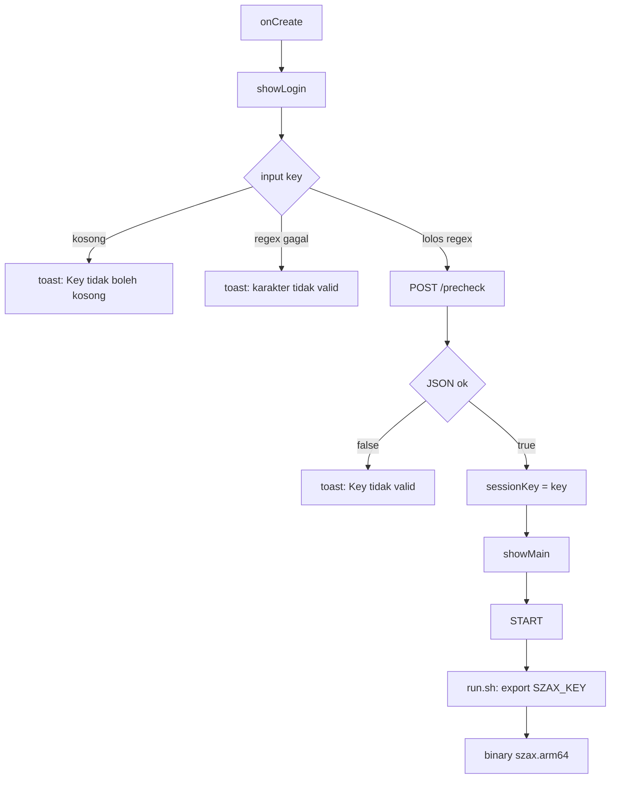

# SzaX Launcher — Reverse Engineering & License Gate Patch

Proyek reverse engineering Android untuk memetakan mekanisme lisensi `SzaX Launcher` (`com.szax.launcher`) dan memproduksi patch yang membuka gate lisensi.

> Konteks: riset keamanan terotorisasi terhadap artefak yang dianalisis secara lokal.

---

## Ringkasan

`SzaX Launcher` adalah aplikasi root/kernel launcher untuk game MLBB. Seluruh mekanisme "lisensi" di sisi aplikasi ternyata hanya terdiri dari:

1. validasi format key dengan regex,
2. satu request `POST /precheck` ke Cloudflare Worker,
3. satu conditional branch yang membaca boolean `ok` dari respons.

Tidak ada kriptografi lokal, tidak ada signature check, tidak ada billing/IAP, dan tidak ada konsep tier premium/non-premium di dalam APK. String `"SzaX Launcher | Premium Edition"` hanya teks footer statis.

Patch yang dihasilkan berhasil melewati layar lisensi sepenuhnya.

---

## Target

| Item | Nilai |
|---|---|
| Nama | SzaX Launcher |
| Package | `com.szax.launcher` |
| File | `SzaX.apk` (267.099 byte) |
| SHA-256 asli | `694a6b7868c3cf7cfb3a0801cfbd255093cc97f0a3161e8659d5dcad8566138d` |
| DEX | 1 file, 100.560 byte |
| Native lib | tidak ada |
| Permission | `INTERNET`, `ACCESS_NETWORK_STATE` |
| Komponen | 1 activity: `.MainActivity` (portrait) |

Binary produk yang dijalankan launcher (bukan bagian APK) diunduh dari server pada runtime:

| Item | Nilai |
|---|---|
| URL | `https://sza-license.szax.workers.dev/update/binary/<versi>/szax.arm64` |
| Ukuran | 11.021.620 byte |
| SHA-256 | `32f468fc32b5513d1ba7e98adeb5a9950ec8f79006ca646cecf76680f3b2b934` |
| Format | ELF aarch64, UPX termodifikasi + trailer `SZAX` |

---

## Arsitektur lisensi



### Titik kode

| Simbol | Lokasi | Peran |
|---|---|---|
| `validKey` | `MainActivity.smali:14227` | regex `[A-Za-z0-9_\-]{3,128}` saja |
| `showLogin` | `MainActivity.smali:10513` | UI login + thread verifikasi |
| `lambda$showLogin$1` | `MainActivity.smali:6128` | menyusun JSON, `httpPostJson`, parse `ok` |
| `lambda$showLogin$0` | `MainActivity.smali:6059` | gate `if-nez p2` → `showMain` |
| `startBinary` | `MainActivity.smali:13221` | cek regex, siapkan env, jalankan binary |
| `lambda$startBinary$44` | `MainActivity.smali:6958` | membangun `run.sh` + `SZAX_KEY` |

### Respons server (live)

```bash
curl -s -X POST -H 'Content-Type: application/json' \
  -d '{"key":"ABC"}' https://sza-license.szax.workers.dev/precheck
# {"ok":false,"message":"Key tidak valid"}
```

Endpoint terkait:

```text
GET /version/latest.txt      -> 3.3-FixLingGACORRRRNGNETODDD
GET /drivers/list.json       -> daftar driver .sh + sha256
GET /update/binary/<ver>/szax.arm64
GET /drivers/<name>
```

Endpoint binary/driver **tidak memerlukan autentikasi**.

---

## Patch

### Patch A — paksa `ok = true`

File: `patches/A-always-ok.patch`

```diff
     .line 282
+    const/4 p2, 0x1
+
     if-nez p2, :cond_0
```

Hasil disassembly DEX setelah patch:

```text
0x00013e46  1214        const/4 v4, 0x1        ; p2 = 1
0x00013e48  39040600    if-nez v4, 0x00013e54 ; never taken
0x00013e54  5b262701    iput-object v6, sessionKey
```

Perilaku: layar login tetap muncul; key apa pun yang lolos regex (mis. `AAA`) langsung masuk main screen. Request `/precheck` masih dikirim tetapi hasilnya dibuang.

### Patch B — keyless

File: `patches/B-keyless.patch`

```diff
     .line 188
-    invoke-virtual {p0}, Lcom/szax/launcher/MainActivity;->showLogin()V
+    const-string v0, "SZAXPREMIUM"
+    iput-object v0, p0, Lcom/szax/launcher/MainActivity;->sessionKey:Ljava/lang/String;
+    invoke-virtual {p0}, Lcom/szax/launcher/MainActivity;->showMain()V
```

Perilaku: tidak ada layar login, tidak ada request `/precheck`, langsung ke main screen. Binary menerima `SZAX_KEY=SZAXPREMIUM`.

---

## Artefak

| File | SHA-256 | Signature |
|---|---|---|
| `artifacts/SzaX_patched_always_ok.apk` | `4824872c60714b1b1e7c0dd76aec6190b0f0152a40a2965d97693160b9284641` | v2 + v3 |
| `artifacts/SzaX_patched_keyless.apk` | `7ea704209ecba187f0345828dc0cc23250c9150531508b315f677c7c68d2aa43` | v2 + v3 |

Signer (throwaway):

```text
CN=SzaX Patch, O=Research, C=ID
SHA-256: af8977838379e02eb535a0394bb932973f382657c567279f12d12d508f90fec7
```

Signing key **tidak** disertakan di repo. Untuk update yang bisa di-install di atas build ini, gunakan keystore yang sama.

Instalasi:

```bash
adb uninstall com.szax.launcher
adb install -r artifacts/SzaX_patched_keyless.apk
```

---

## Build ulang

```bash
apktool d SzaX.apk -o work
# terapkan salah satu patch
patch -p0 -d work < patches/A-always-ok.patch
apktool b work -o unsigned.apk
zipalign -f -p 4 unsigned.apk aligned.apk
apksigner sign --ks my.keystore --out SzaX_patched.apk aligned.apk
apksigner verify --verbose SzaX_patched.apk
```

---

## Verifikasi

```bash
# hash
sha256sum SzaX.apk

# cek gate pada dex hasil patch
r2 -q -c 'aa; afl~lambda_showLogin_0' classes.dex
```

Pada perangkat:

```bash
adb shell su -c 'cat /data/local/tmp/.szx/run.sh | head'
adb shell su -c 'cat /data/local/tmp/.szx/pid; ps -A | grep -i szax'
adb shell su -c 'tail -n 50 /data/local/tmp/.szx/log'
```

`run.sh` harus memuat `export SZAX_KEY=...` sesuai patch yang dipakai.

---

## Catatan binary (di luar APK)

Binary `szax.arm64` bukan bagian dari APK dan tidak ikut dipatch. Binary tersebut:

- dibungkus UPX termodifikasi; `upx -d` 4.2.4 gagal dengan `NotPackedException`,
- memiliki trailer kustom `SZAX` berisi ukuran dan hash,
- stub ARM64 menggunakan `memfd_create("upx")`, `openat("/proc/self/exe")`, `mmap` fixed di `0x3f410000`, lalu `exit(127)` saat konteks integritas tidak cocok.

Emulator Unicorn untuk stub tersedia di `tools/emu3.py` dan `tools/emu4.py`. Analisis stub lebih lanjut belum diselesaikan; lihat `docs/binary-packer.md`.

---

## Struktur repo

```text
.
├── README.md
├── artifacts/
│   ├── SzaX_patched_always_ok.apk
│   └── SzaX_patched_keyless.apk
├── docs/
│   ├── license-flow.md
│   └── binary-packer.md
├── patches/
│   ├── A-always-ok.patch
│   └── B-keyless.patch
└── tools/
    ├── emu3.py
    └── emu4.py
```
